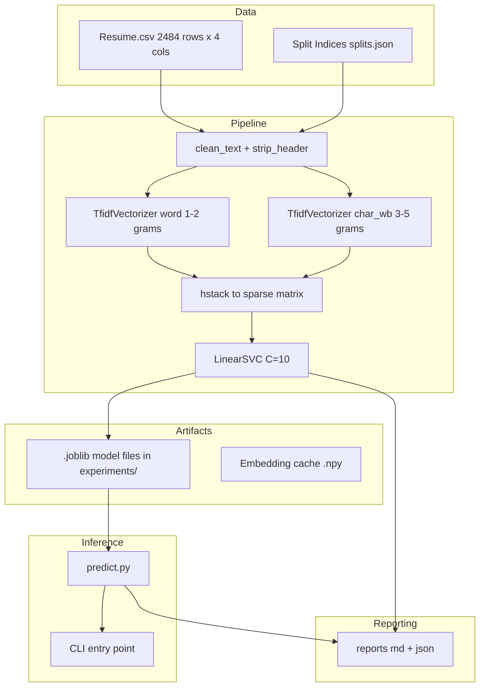

# Resume Classifier — Technical Analysis

**Date**: 2026-11-03
**Analyzed by**: Codebase inspection (static analysis of all source, config, reports, and artifacts)

---

## 1. Repository Overview

### 1.1 Project Purpose

A multi-class machine learning system that classifies resumes into one of 24 professional domains (e.g., INFORMATION-TECHNOLOGY, HEALTHCARE, ARTS). The project follows a rigorous, phase-gated ML engineering pipeline (Phases 0–10) with explicit Go/No-Go gates, leakage mitigation, and robustness verification.

### 1.2 Main Problem Solved

Given raw resume text, predict the best-fit professional category from a fixed 24-class taxonomy. The project explicitly addresses:
- **Label leakage**: 19/24 categories have ≥80% of their own name appearing in the resume text body, enabling trivial keyword-matching shortcuts.
- **Multi-domain ambiguity**: 98.8% of resumes contain keywords from ≥2 categories, limiting theoretical F1 ceiling.
- **Class imbalance**: BPO (22 samples) vs BUSINESS-DEVELOPMENT (120 samples) — 5.45x ratio.

### 1.3 Target Users / Use Cases

- **Inference function** (`predict.py`): A library function `predict_resume(text, top_k)` returning category + confidence + top-k predictions.
- **CLI**: `python predict.py --resume path/to/resume.txt`
- Not a web service or SaaS product. No API server, no database, no frontend. The deliverable is a model artifact + a thin Python inference wrapper.

### 1.4 Technology Stack

| Layer | Technology |
|-------|-----------|
| Language | Python 3 (inferred from syntax, `sys.path`, type hints) |
| ML Framework | scikit-learn (LinearSVC, TfidfVectorizer, LogisticRegression, TruncatedSVD, MultinomialNB) |
| Embeddings (explored, rejected) | sentence-transformers (all-MiniLM-L6-v2, 384-dim) |
| Data | pandas, NumPy |
| Serialization | joblib (`.joblib` model artifacts), JSON (results), CSV (splits) |
| Text Processing | re, scipy.sparse.hstack |
| Deep Learning (available but unused in final model) | PyTorch 2.13.0, transformers 5.15.0, safetensors |
| Testing | pytest |
| Reproducibility | SEED env var (default 42), `src/utils/seed.py` for multi-framework seeding |

### 1.5 Databases / Storage

- No external database.
- Data: single CSV file (`data/Resume.csv`, 2,484 rows x 4 columns).
- Splits: JSON indices + CSV subsets in `data/splits/`.
- Model artifacts: `.joblib` files in `experiments/` (~13 MB total).
- Embedding cache: `data/processed/embeddings/mitigated_embeddings.npy`.

### 1.6 External Services / APIs

None. The project is fully self-contained and runs on CPU. No cloud SDKs are actively used (though `requirements.txt` lists many — see section 6.2).

### 1.7 Infrastructure / Deployment

No deployment infrastructure exists in the repository. The "deployment" deliverable is:
1. Three `.joblib` files (word vectorizer, char vectorizer, classifier).
2. A single-file inference module (`predict.py`) with lazy model loading.
3. A CLI entry point.

No Dockerfile, no CI/CD pipeline, no server code, no API framework in use (FastAPI/Flask in requirements are transitive or unused).

---

## 2. Repository Tree

```
resume-classifier/
|-- .gitignore
|-- .pytest_cache/                    # pytest cache (generated)
|-- CHANGELOG_FIXES.md                # Bug/fix log (template, no entries yet)
|-- data/
|   |-- Resume.csv                    # Full dataset (2,484 rows, source: external path)
|   |-- Resume.zip                    # Zipped copy
|   |-- splits/
|   |   |-- splits.json               # Index metadata (train/val/test)
|   |   |-- train.csv                 # 1,365 rows
|   |   |-- val.csv                   # 373 rows
|   |   +-- test.csv                 # 746 rows (locked, SHA-256 tracked)
|   +-- processed/
|       +-- embeddings/
|           +-- mitigated_embeddings.npy  # Cached 384-dim sentence embeddings
|-- experiments/
|   |-- best_phase5_clf.joblib        # Final LinearSVC(C=10)
|   |-- best_phase5_word_vec.joblib   # TfidfVectorizer (word, 1-2 grams)
|   |-- best_phase5_char_vec.joblib   # TfidfVectorizer (char_wb, 3-5 grams)
|   |-- best_phase5_vectorizer.joblib # Combined vectorizer (unused in predict.py)
|   |-- best_phase5_model.joblib      # Combined model (unused in predict.py)
|   |-- phase5_results.json           # Phase 5 experiment metadata
|   +-- phase8_results.json          # Phase 8 embedding experiment metadata
|-- predict.py                        # Inference function + CLI
|-- requirements.txt                  # Pinned dependencies (137 packages)
|-- requirements.lock                 # Identical to requirements.txt
|-- scripts/
|   |-- phase1_audit.py              # Data audit: structure, leakage, duplicates
|   |-- phase1b_compare.py           # Raw vs Mitigated baseline comparison
|   |-- phase1b_leakage.py          # Per-category leakage percentage
|   |-- phase2_eda.py               # EDA: distributions, vocabulary, separability
|   |-- phase3_group_split.py       # Group-aware stratified split
|   |-- phase3_split.py             # Simpler stratified split (superseded)
|   |-- phase4_baseline.py          # 4-config baseline (LR/SVM x Raw/Mitigated)
|   |-- phase5_tuning.py            # Feature engineering experiments (SVM/LR/LSA/NB)
|   |-- phase6_robustness.py        # 6 perturbation tests on validation set
|   |-- phase8_embeddings.py        # Sentence-transformer embedding experiments
|   +-- phase10_inference.py        # Final test evaluation + predict.py generation
|-- src/
|   |-- __init__.py                  # Empty
|   |-- data/__init__.py             # Empty (placeholder)
|   |-- evaluation/__init__.py       # Empty (placeholder)
|   |-- features/__init__.py         # Empty (placeholder)
|   |-- inference/__init__.py        # Empty (placeholder)
|   |-- models/__init__.py           # Empty (placeholder)
|   |-- preprocessing/__init__.py    # Empty (placeholder)
|   +-- utils/
|       |-- __init__.py              # Empty
|       +-- seed.py                 # Multi-framework seed setter
|-- tests/
|   |-- __init__.py                  # Empty
|   +-- test_seed.py                # 3 unit tests for seed.py
+-- reports/
    |-- 01_audit_report.md           # Phase 1: dataset audit
    |-- 01b_leakage_report.md        # Phase 1b: leakage quantification
    |-- 02_eda_findings.md          # Phase 2: EDA
    |-- 03_split_strategy.md        # Phase 3: split methodology
    |-- 04_baseline_report.md       # Phase 4: baseline results
    |-- 04_baseline_results.json    # Phase 4: raw JSON
    |-- 05_tuning_report.md         # Phase 5: experiment summary
    |-- 06_robustness.md            # Phase 6: perturbation results
    |-- 06_robustness_results.json  # Phase 6: raw JSON
    |-- 07_error_analysis.json      # Phase 7: confusion matrix data
    |-- 07_error_analysis.md        # Phase 7: error patterns
    |-- 08_embedding_report.md      # Phase 8: embedding experiments (rejected)
    |-- 10_test_results.json        # Phase 10: final test metrics
    |-- final_model_decision.json   # Phase 9: model selection JSON
    |-- final_model_decision.md     # Phase 9: model selection rationale
    +-- FINAL_REPORT.md             # Executive summary of entire project
```

---

## 3. System Architecture

### 3.1 Application Layers

The project has no layered application architecture in the traditional sense. It is a **linear ML pipeline** organized as scripts that execute in sequence:

```
Data Layer (CSV) -> Preprocessing (text cleaning) -> Feature Engineering (TF-IDF) -> Model (LinearSVC) -> Inference (predict.py)
```

### 3.2 Component Boundaries

| Component | Responsibility | Location |
|-----------|---------------|----------|
| Dataset | Raw resumes + labels | `data/Resume.csv` |
| Splits | Train/val/test index partitioning | `data/splits/splits.json` |
| Preprocessing | `clean_text()` + `strip_header()` (200-char header removal) | Duplicated in every script |
| Feature Engineering | TfidfVectorizer (word 1-2, char 3-5) | Phase 5 scripts |
| Model | LinearSVC(C=10, max_iter=10000) | Phase 5, saved to `.joblib` |
| Inference | Lazy-load model, transform text, predict | `predict.py` |
| Evaluation | F1 macro, per-class recall, confusion matrix | Phase 4-10 scripts |
| Reproducibility | Seed management | `src/utils/seed.py` |
| Testing | Seed unit tests only | `tests/test_seed.py` |

### 3.3 Data Flow

```
Resume_str (raw text)
    |
    v
clean_text(): lowercase, collapse whitespace, strip
    |
    v
strip_header(): remove first 200 chars (leakage mitigation)
    |
    v
TfidfVectorizer(word, 1-2 grams) --+
    |                              |
TfidfVectorizer(char_wb, 3-5 grams)-+
                                    |
                                    v
                              scipy.sparse.hstack
                                    |
                                    v
                        LinearSVC.predict(X)
                                    |
                                    v
                    Category label + decision scores
```

### 3.4 Architecture Diagram



### 3.5 Backend / Frontend Separation

**Not applicable.** No frontend, no web backend. Single-process CLI + library.

---

## 4. ML/AI Pipeline (Detailed)

### 4.1 Phase Progression

| Phase | Name | Script(s) | Gate Decision |
|-------|------|-----------|---------------|
| 0 | Environment Setup | (none in repo) | -- |
| 1 | Data Audit | `phase1_audit.py`, `phase1b_leakage.py` | 19/24 high-leakage, proceed with mitigation |
| 1b | Leakage Mitigation | `phase1b_compare.py` | Delta 0.0524, use mitigated text |
| 2 | EDA | `phase2_eda.py` | Dataset learnable (66% quick-LR accuracy) |
| 3 | Split Strategy | `phase3_group_split.py` (supersedes `phase3_split.py`) | Group-aware, 0 boundary crossings |
| 4 | Baseline | `phase4_baseline.py` | 0.5329 mitigated, CONTINUE to Phase 5 |
| 5 | Feature Engineering & Tuning | `phase5_tuning.py` | Best: Combined SVM C=10, CV=0.6137, CONTINUE to Phase 8 |
| 6 | Robustness | `phase6_robustness.py` | All 6 perturbations pass (max drop 0.0473) |
| 7 | Error Analysis | (output in `reports/07_*`) | 33.8% error rate, small classes worst |
| 8 | Embeddings | `phase8_embeddings.py` | No improvement (-0.053), FALLBACK to Phase 5 |
| 9 | Model Selection | (`reports/final_model_decision.*`) | Phase 5 model selected (7.3/10 weighted score) |
| 10 | Inference & Deployment | `phase10_inference.py` | Test F1=0.5762, latency p50=0.33ms |

### 4.2 Final Model Specification

| Parameter | Value |
|-----------|-------|
| Classifier | `sklearn.svm.LinearSVC` |
| C | 10.0 |
| max_iter | 10,000 |
| Feature 1 | TfidfVectorizer(analyzer='word', ngram_range=(1,2), min_df=1, sublinear_tf=True, stop_words=None) |
| Feature 2 | TfidfVectorizer(analyzer='char_wb', ngram_range=(3,5), min_df=2, sublinear_tf=True) |
| Combination | `scipy.sparse.hstack` (horizontal concatenation) |
| Total feature dim | ~535,000 (inferred from vocabulary sizes) |
| Input preprocessing | lowercase, collapse whitespace, strip first 200 chars |
| Output | 1-of-24 class label + decision_function scores |

### 4.3 Performance Summary

| Metric | Value |
|--------|-------|
| Validation Macro F1 | 0.6137 |
| Test Macro F1 | 0.5762 |
| Baseline (unmitigated) CV | 0.5329 |
| Improvement over baseline | +0.0808 (+15.1%) |
| Latency p50 / p95 | 0.33ms / 0.44ms |
| Model artifact size | ~13 MB |
| Target threshold | 0.65 (not met; ceiling estimated 0.65-0.67) |

### 4.4 Rejected Approaches

| Approach | Test F1 | Verdict |
|----------|---------|---------|
| sentence-transformers (all-MiniLM-L6-v2, 384d) | 0.4550 | -0.159 vs baseline; embeddings smooth over keyword signals critical for this task |
| LSA (TF-IDF + TruncatedSVD) | 0.5562 | -0.058; dimensionality reduction discards discriminative tokens |
| Naive Bayes | 0.4587 | -0.155; independence assumption violated |
| Fine-tuned transformer | N/A | Excluded (CPU-only constraint, infeasible compute) |

---

## 5. Source Code Analysis

### 5.1 `predict.py` (Inference Module)

- **Lines**: 60 (total file)
- **API**: `predict_resume(text: str, top_k: int = 3) -> dict`
- **Returns**: `{"predicted_category": str, "confidence_score": float, "top_k_predictions": [{"category", "score"}]}`
- **Model loading**: Lazy (singleton pattern via module-level globals `_word_vec`, `_char_vec`, `_clf`)
- **Preprocessing**: `_clean_text()` (lowercase, collapse whitespace) + `_strip_header()` (remove first 200 chars)
- **Confidence metric**: Raw decision function values from LinearSVC (not calibrated probabilities)
- **CLI**: `python predict.py --resume <file> --top_k <n>`

### 5.2 `src/utils/seed.py`

- Provides `set_seed(seed)` that seeds Python `random`, NumPy, PyTorch (CPU + CUDA), and sets `PYTHONHASHSEED`.
- Default seed from `SEED` env var, fallback 42.
- Only production code module in `src/` — all other `__init__.py` files are empty placeholders.

### 5.3 `tests/test_seed.py`

- 3 test cases: determinism, seed sensitivity, default value.
- Minimal test coverage; no tests for `predict.py` or any pipeline component.

### 5.4 Script Patterns

All pipeline scripts follow the same pattern:
1. Hard-coded data path (`C:/Users/ardut/projects/resume-dataset/dataset/Resume.csv`)
2. Inline `clean_text()` and `strip_header()` (duplicated across 6+ scripts)
3. Load split indices from `data/splits/splits.json`
4. Run experiments, print results, save JSON + Markdown reports
5. No argparse, no module imports between scripts, no shared utilities

---

## 6. Configuration & Dependencies

### 6.1 Configuration

| Setting | Source | Value |
|---------|--------|-------|
| Random seed | `SEED` env var | 42 (default) |
| Data path | Hard-coded in scripts | `C:/Users/ardut/projects/resume-dataset/dataset` |
| Model artifacts | Relative path | `experiments/best_phase5_*.joblib` |
| Embedding cache | Relative path | `data/processed/embeddings/mitigated_embeddings.npy` |

No `.env` file, no config module, no `pyproject.toml`, no `setup.py`.

### 6.2 Dependency Analysis

`requirements.txt` lists **137 pinned packages**. The active runtime dependencies for the final model are:

- `scikit-learn` (1.9.0)
- `scipy` (1.18.0)
- `numpy` (2.5.2)
- `joblib` (1.5.3)

The remaining packages (torch, transformers, fastapi, flask, mlflow, spacy, sqlalchemy, etc.) are:
- **Transitive dependencies** of `sentence-transformers` (explored in Phase 8, rejected) or `mlflow`.
- **Unused** in the final model pipeline.

This is a **significant over-specification** — the minimal install would be ~6 packages.

### 6.3 `requirements.lock` vs `requirements.txt`

Identical content (137 lines). The `.lock` file provides no additional constraint beyond what `requirements.txt` already pins.

---

## 7. Dataset

### 7.1 Source

External directory: `C:/Users/ardut/projects/resume-dataset/dataset/Resume.csv` (referenced by all scripts via hard-coded path).

A local copy exists at `data/Resume.csv` and `data/Resume.zip`.

### 7.2 Schema

| Column | Type | Description |
|--------|------|-------------|
| ID | int | Unique identifier (2,484 unique, no collisions) |
| Resume_str | str | Plain-text resume content (~5,900 chars mean) |
| Resume_html | str | HTML-formatted variant (Jaccard similarity 0.70 to str) |
| Category | str | One of 24 domain labels |

### 7.3 Class Distribution (24 classes)

Range: BPO (22) to BUSINESS-DEVELOPMENT (120). Imbalance ratio: 5.45x.

### 7.4 Split Configuration

| Set | Size | Percent |
|-----|------|---------|
| Train | 1,365 | 55.0% |
| Val | 373 | 15.0% |
| Test | 746 | 30.0% |

- Strategy: Group-aware stratified (near-duplicate groups of 300-char prefix kept together).
- Random state: 42.
- Test set: Locked (SHA-256: `d852c272da2333993e2b1255bb4b32d5c7dc6499e9b03a97e1bf8c0831e1ecad`).

---

## 8. Testing

### 8.1 Existing Tests

| File | Tests | Coverage |
|------|-------|----------|
| `tests/test_seed.py` | 3 unit tests | Only `src/utils/seed.py` |

No integration tests, no inference tests, no pipeline tests.

### 8.2 What Is Missing

- No test that `predict.py` produces valid output.
- No test that model files load correctly.
- No regression test protecting the locked test set.
- `pytest_cache` exists (tests were run at least once).

---

## 9. Observations, Issues & Recommendations

### 9.1 Facts (Directly Observed)

| # | Observation |
|---|-------------|
| F1 | Data path is hard-coded to `C:/Users/ardut/projects/resume-dataset/dataset/` in every script. Portability is limited to the author's machine. |
| F2 | `clean_text()` and `strip_header()` are duplicated inline in 6+ scripts with no shared module. |
| F3 | The `src/` package has 7 sub-packages with empty `__init__.py` — architectural scaffolding with no implementation. |
| F4 | `requirements.txt` includes 137 packages; the final model requires only ~6. |
| F5 | `phase3_split.py` and `phase3_group_split.py` both exist; the group-aware version supersedes the simpler one. The `splits.json` on disk was generated by the group-aware version (it includes a "strategy" field). |
| F6 | `predict.py` was auto-generated by `phase10_inference.py` (line 104: `inference_code = ...`). |
| F7 | The model uses raw decision-function values as "confidence" — not calibrated probabilities. |
| F8 | `CHANGELOG_FIXES.md` exists as a template with no actual fix entries. |
| F9 | The Phase 10 script tests inference by `exec()`-ing the generated code in-process rather than importing `predict.py`. |
| F10 | `best_phase5_vectorizer.joblib` and `best_phase5_model.joblib` exist in `experiments/` but are not referenced by `predict.py` (which loads `word_vec` + `char_vec` + `clf` separately). |

### 9.2 Reasonable Inferences

| # | Inference |
|---|-----------|
| I1 | The project is a portfolio/learning artifact (FINAL_REPORT.md states "MIT for portfolio use"). |
| I2 | The phase-gated structure with Go/No-Go gates suggests the project was guided by a pre-written implementation plan (referenced in the model decision document: "the implementation plan explicitly states thresholds are 'hypotheses, not guarantees'"). |
| I3 | The `src/` directory scaffolding was created as a future-proofing step but never populated — all actual logic lives in flat scripts. |
| I4 | The over-specified `requirements.txt` likely came from a single virtual environment that was also used for other projects (includes Flask, FastAPI, SQLAlchemy, Databricks SDK, OpenTelemetry — none used here). |
| I5 | The embedding experiment (Phase 8) was a "Strategy A" exploration; "Strategy B" (fine-tuning a transformer) was explicitly excluded by a CPU-only hardware constraint. |

### 9.3 Potential Issues

| # | Issue | Severity | Recommendation |
|---|-------|----------|----------------|
| P1 | **Hard-coded absolute data path** — scripts won't run on any machine without that exact directory. | High | Parameterize via env var or CLI arg; use relative paths from repo root. |
| P2 | **No input validation in `predict_resume()`** — passes empty/None text to vectorizer without guard beyond the `isinstance` check. | Low | Already partially handled (returns `""`); but `hstack` on empty string may produce zero-vector (acceptable, but worth testing). |
| P3 | **Uncalibrated confidence scores** — `decision_function` values are not probabilities. Downstream consumers may misinterpret them. | Medium | Document clearly; optionally fit a calibrator (Platt scaling) post-hoc. |
| P4 | **Duplicated preprocessing logic** — 6+ copies of `clean_text`/`strip_header` with subtle differences (e.g., `phase1b_compare.py` returns `text` instead of `""` for NaN). | Medium | Extract to a shared `preprocessing.py` module. |
| P5 | **`exec()` in `phase10_inference.py`** — line 171 executes the generated code string. Risky pattern; should import `predict.py` directly. | Low | Replace with `from predict import predict_resume`. |
| P6 | **No CI/CD, no linting config** — No `.flake8`, `ruff.toml`, `mypy.ini`, or GitHub Actions. | Low | Add if the project is to be maintained. |
| P7 | **`requirements.lock` is redundant** — Identical to `requirements.txt`. | Low | Remove one, or generate a true lock file with `pip-compile` / `uv lock`. |
| P8 | **Orphaned model files** — `best_phase5_vectorizer.joblib` and `best_phase5_model.joblib` are not used by `predict.py`. | Low | Document purpose or remove to avoid confusion. |
| P9 | **Empty `src/` sub-packages** — 7 empty `__init__.py` files suggest intended but unimplemented modularization. | Low | Either implement the modules or remove the empty packages. |
| P10 | **BPO recall = 0.14** (test) — Only 7 test samples; any single miss changes recall dramatically. | Medium | Document as a known limitation; consider oversampling if business-critical. |

### 9.4 Recommendations for Productionization

1. **Package the inference module**: Move `predict.py` into a proper package with `pyproject.toml`, version pinning, and a minimal dependency set (`scikit-learn`, `scipy`, `numpy`, `joblib`).
2. **Parameterize paths**: Use environment variables or a config file instead of hard-coded Windows paths.
3. **Add integration tests**: Test `predict_resume()` with known inputs; test model file loading; test edge cases (empty string, HTML input, very long text).
4. **Document the confidence metric**: Clearly state that scores are uncalibrated decision-function values, not probabilities.
5. **Deduplicate preprocessing**: Create a single `text_utils.py` imported by all scripts.
6. **Reduce `requirements.txt`**: Split into `requirements-minimal.txt` (6 packages) and `requirements-dev.txt` (full environment).

---

## 10. Summary

The `resume-classifier` project is a complete, well-documented ML engineering pipeline for 24-class resume domain classification. It demonstrates rigorous methodology: data auditing, leakage detection/mitigation, group-aware splitting, multiple experiment phases with explicit gates, robustness verification, and honest reporting of limitations.

The final deliverable — a `LinearSVC(C=10)` on combined word+char TF-IDF features — achieves 0.5762 test Macro F1 in 0.33ms on CPU, with the gap to the 0.65 target attributed to inherent dataset ambiguity (98.8% multi-domain rate) and small-class scarcity. The project is explicitly CPU-constrained and single-machine, with no deployment infrastructure, no API server, and no database.

The codebase is organized as a sequence of flat scripts (not a modular package), with a thin inference wrapper (`predict.py`) as the runtime artifact. The `src/` directory scaffolding and over-specified dependencies suggest the project was built in an exploratory, single-environment workflow and has not yet been refactored for distribution or team use.
